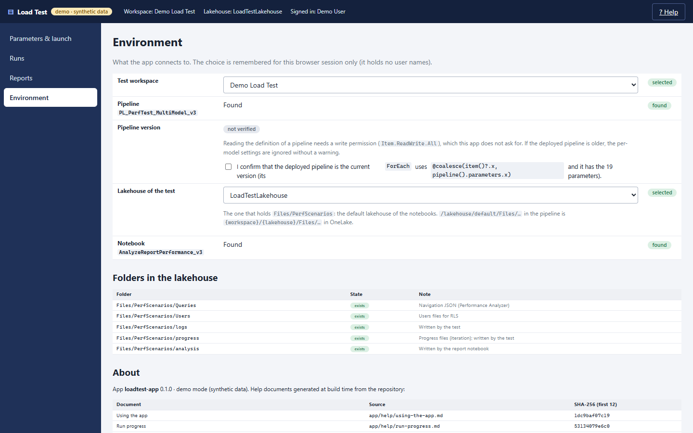
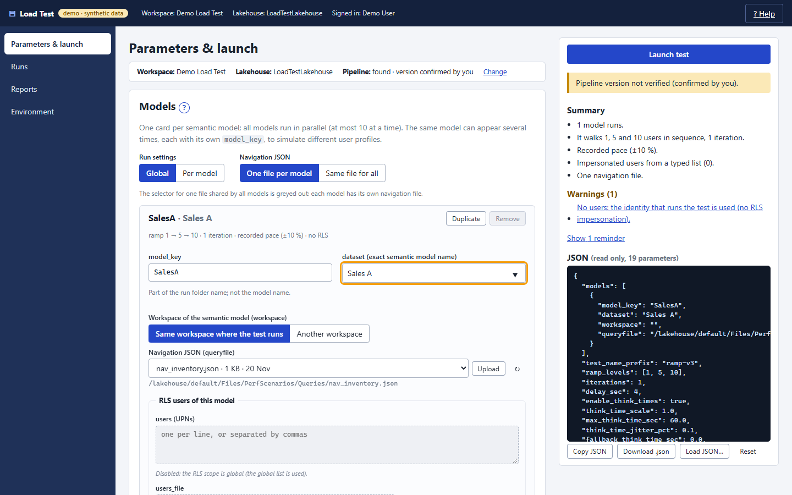
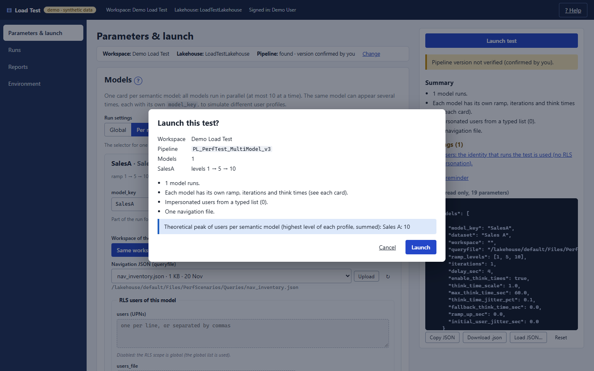
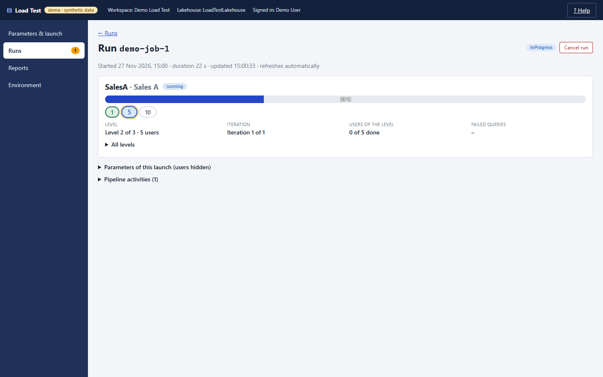
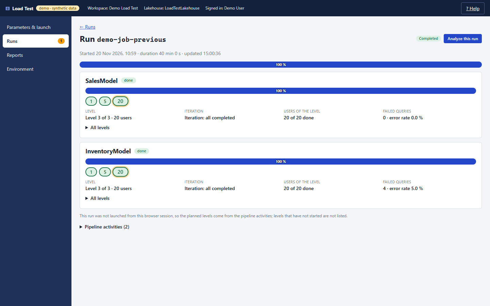
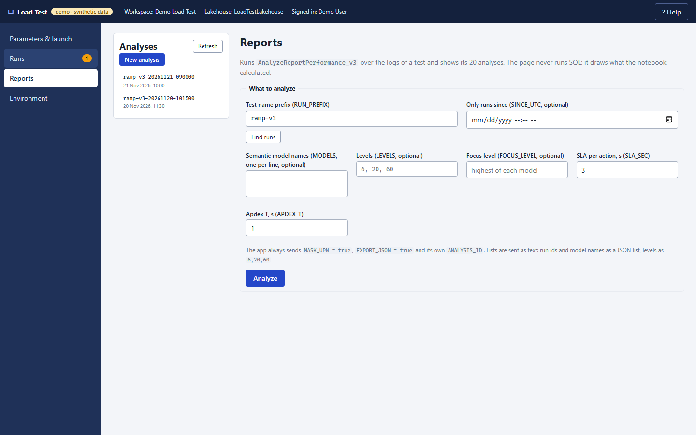
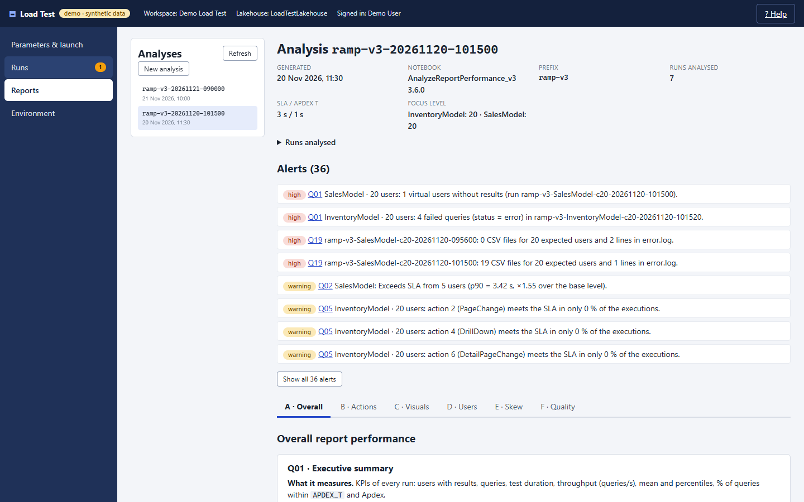
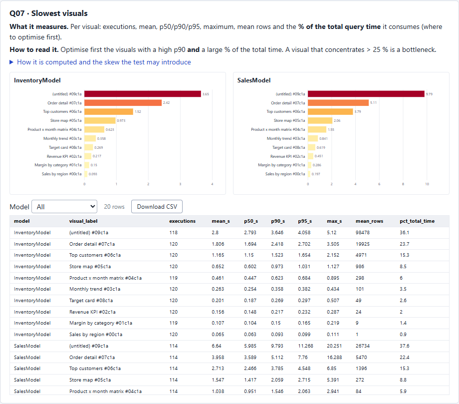
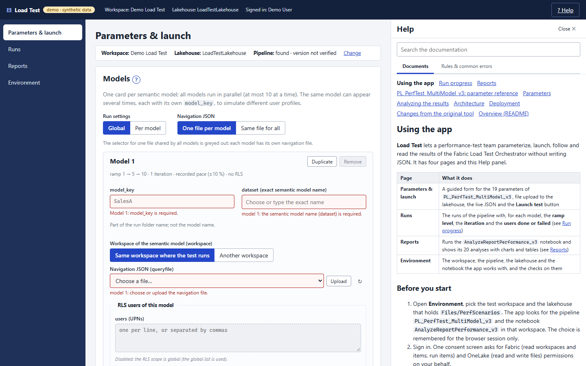

# Load Test (Fabric App)

A single-page app (React + TypeScript + Vite) that lets a performance-test team **parameterize, launch, follow and read the results** of the
Fabric Load Test Orchestrator without writing JSON. It is deployed as a Fabric App with `rayfin-cli` (static hosting) and calls the Fabric and
OneLake APIs with the **signed-in user's** delegated token. It has no database and no backend of its own.

| Page | What it does |
|---|---|
| **Parameters & launch** | Guided form for the 19 parameters of `PL_PerfTest_MultiModel_v3` (three exclusion modes, model cards, upload of navigation JSON and users files), live JSON, and **Launch test** |
| **Runs** | Runs of the pipeline; for each model the ramp **level**, the **iteration**, users done or failed, failed queries and error rate; cancel |
| **Reports** | Runs `AnalyzeReportPerformance_v3` and shows its 20 analyses (alerts, charts, sortable tables, CSV download) |
| **Environment** | Workspace, pipeline, lakehouse and notebook the app works with, and the checks on them |
| **Help** (side panel) | The repository documentation, generated at build time, with search and a link from every parameter to its section |

The app does not use the promotion gate (`promotion-gate/`); it is independent of it.

## Screenshots

Taken in the app's **demo mode** (`npm run dev:demo`): every name, run and result is synthetic.

**Environment** — the workspace, pipeline, lakehouse and notebook the app works with, and the folders it needs.



**Parameters & launch** — a guided form for the 19 parameters. Exclusive options are buttons, fields that do not apply are greyed out, and the JSON that will be sent is always visible.



With *Run settings → Per model* every model card carries its own ramp, iterations and think times.


A confirmation shows the workspace, the pipeline, the levels of each model and the theoretical peak of users per semantic model.



**Runs** — for each model the level of the ramp, the iteration, the users done and the failed queries, updated while the test runs.





**Reports** — runs `AnalyzeReportPerformance_v3` over the logs of a test and shows its alerts and the 20 analyses with charts and sortable tables.







**Help** — the repository documentation, searchable, with a link from every parameter to its section.



## Prerequisites

- Node **20, 22 or 24** (`rayfin-cli` does not support Node 26: `npm ci` warns with `EBADENGINE`).
- A Microsoft Entra **single-page application** registration (steps below) and a workspace in a region that supports Fabric Apps.
- The orchestrator deployed in a workspace (`PL_PerfTest_MultiModel_v3`, `PL_PerfTest_Ramp_v3`, the notebooks) with a lakehouse that holds `Files/PerfScenarios`.
  Notebooks and pipelines of this repository version (per-model settings, progress files, `summary.json`, `EXPORT_JSON` in the report notebook).
- Tenant settings: Fabric data apps (Rayfin) enabled, and the XMLA read endpoint on the capacity (for the tests themselves).

## Configuration (environment variables)

Copy `.env.example` to `.env`. The frontend is public: **no secrets**, only ids.

| Variable | Required | Meaning |
|---|---|---|
| `VITE_MSAL_CLIENT_ID` | yes | Client id of the Entra SPA registration |
| `VITE_MSAL_TENANT_ID` | no | Tenant id (default `organizations`) |
| `VITE_DEFAULT_WORKSPACE_ID` | no | Workspace preselected on the Environment page |
| `VITE_WARN_WORKSPACES` | no | Comma-separated display names of workspaces that must not be used for tests (the app warns) |
| `VITE_DEMO_MODE` | no | `true` = demo with synthetic data (set by `.env.demo`) |
| `LOADTEST_REPO_ROOT` | no | Build time only: root of the repository that the help is generated from (default: the parent of `app/`) |

`rayfin up` also writes `.env.local` (`VITE_RAYFIN_*`, `VITE_FABRIC_*`); do not edit it.

## Local development, tests and build

```powershell
npm ci
npm run dev:demo      # everything with synthetic data, no sign-in, no Azure (a pipeline run that advances, uploads, reports)
npm run dev           # against Fabric (needs .env and an Entra registration with http://localhost:5173/blank.html)
npm run typecheck
npm test              # vitest
npm run build         # tsc + vite build  (fails on a broken help link)
npm run build:demo    # the same with the demo mode compiled in
```

> **Do not run `npm` inside OneDrive** (thousands of small files). Work in a scratch copy of the repository (for example `P:\temp\loadtest-app-build\`,
> with `app\`, `docs\`, `notebooks\`, `pipelines\`, `samples\`, `upstream\`, `README.md`… next to each other) and copy back only the sources,
> `package.json` and `package-lock.json`. `deploy/deploy-app.ps1` does exactly that. Never commit `node_modules`, `dist`, `.env`, `.pem` or `.rayfin`.

### Help generated at build time

`tools/helpbuild.ts` (loaded by a Vite plugin as the module `virtual:help`) reads `README.md`, `docs/*.md` (except `docs/agent-deployment.md`, which is for AI agents),
the three guides in `app/help/` and the markdown cells `## Qnn` of `notebooks/AnalyzeReportPerformance_v3.ipynb` (the "What it measures / How to read it" of each query).
The **build fails** if a document or the notebook is missing, an internal link or anchor is broken (anchors follow GitHub's algorithm), a link to a repository file points to a file
that does not exist, there is unsafe HTML, or a query has no header. The *Promotion gate* section of the README is left out. The Environment page lists the embedded documents with their SHA-256.

### Tests

`npm test` runs 100+ unit tests: the parameter schema against the pipeline JSON (names, types, defaults, the ten `coalesce` keys), the JSON generator in every combination of the three modes
(including per-model `false`, `0`, `0.0`, greyed fields not emitted, all 19 parameters always emitted, GUID in `workspace` blocked), the documented RLS recipes, examples and the validated
`ProfA/ProfB/ProfC` configuration, the validators (navigation JSON as `RunPerfScenario_v3` reads it; users file rules of `RunLoadTest_v3`), launch gating and job location,
progress computation (activity runs, folders, CSV, heartbeat, `summary.json`, `error.log`), the manifest reader (including `no_data` and `error`), the chart contract (every chart type renders
from the demo analysis; every column named by a spec exists), the help build checks, UPN privacy (nothing stored, logged or shown unmasked, in a mounted app), and the accessibility primitives.

## Entra registration (SPA, once)

1. Entra admin center → *App registrations* → *New registration*. Name: for example `loadtest-app`. Supported account types: this tenant.
2. *Authentication* → *Add a platform* → **Single-page application**. Redirect URIs (type SPA, **no secret**, PKCE is used):
   - `http://localhost:5173/blank.html` (local development)
   - `<origin>/blank.html` of the deployed app, for example `https://<name>.webapp.fabricapps.net/blank.html` (the URL that `rayfin up` prints)
3. *API permissions* → *Add a permission* (all **delegated**):
   - **Fabric API** (`https://api.fabric.microsoft.com`): `Workspace.Read.All`, `Item.Read.All`, `Item.Execute.All`
   - **Azure Storage** (`https://storage.azure.com`): `user_impersonation` (OneLake)
4. Copy the *Application (client) ID* to `VITE_MSAL_CLIENT_ID` and the tenant id to `VITE_MSAL_TENANT_ID`.

The app asks for consent in **one popup** at the first sign-in. It does **not** ask for any write, deployment-pipeline or `Item.ReadWrite.All` permission.
Inside the Fabric portal the app runs in an iframe with partitioned storage: sign-in uses the popup relay (`popup-relay.html`) and the silent renewal uses `blank.html`.
The first click on *Sign in* inside the portal may only open the hosting sign-in: click again. The VS Code integrated browser blocks `window.open`: test the sign-in in a normal browser.

## Deploy as a Fabric App with rayfin

The app needs only the static hosting and the Fabric sign-in of Rayfin (`rayfin/rayfin.yml` has the data service disabled).

```powershell
# from a scratch copy of the repository (see above), in app\
npm ci
Copy-Item .env.example .env      # then fill in VITE_MSAL_CLIENT_ID (and VITE_MSAL_TENANT_ID)
npx rayfin login                 # or set RAYFIN_TOKEN (token of https://api.fabric.microsoft.com) and RAYFIN_TENANT_ID
npx rayfin up --workspace-id <app workspace guid> --item-name LoadTestApp --yes
```

`rayfin up` builds (`npm run build`), publishes `dist/` and prints the hosting URL. Add `<that url>/blank.html` to the SPA redirect URIs. Open the app from the Fabric portal.
`rayfin up` adds the hosting URL to `rayfin/rayfin.yml`; restore the file if you do not want that change in git.

**Or use the script** `deploy/deploy-app.ps1`, small and fully parameterised (no ids inside): it copies the repository to a scratch folder, writes `.env`, runs `npm ci` and `rayfin up`.

```powershell
pwsh app\deploy\deploy-app.ps1 -AppWorkspaceId <guid> -ClientId <guid> -TenantId <guid> -DefaultWorkspaceId <guid> -WhatIf   # plan only
pwsh app\deploy\deploy-app.ps1 -AppWorkspaceId <guid> -ClientId <guid> -TenantId <guid> -UseAzToken
```

## What the app reads and writes

| API | Used for |
|---|---|
| `GET /v1/workspaces`, `GET /v1/workspaces/{id}/items?type=…` | Workspaces, pipeline, notebook, lakehouses and semantic models (existence check of every `dataset`) |
| `POST …/items/{pipeline}/jobs/instances?jobType=Pipeline` | Launch (`{"executionData":{"parameters": …}}`, the same JSON that is shown and copied) |
| `GET …/jobs/instances`, `…/{id}`, `POST …/{id}/cancel` | Runs list, state, cancel |
| `POST …/datapipelines/pipelineruns/{id}/queryactivityruns` | The ExecutePipeline activity of each model and the notebook activity of each level (also of each child run) |
| `POST …/items/{notebook}/jobs/instances?jobType=RunNotebook` | Runs `AnalyzeReportPerformance_v3` with typed parameters |
| OneLake DFS (`onelake.dfs.fabric.microsoft.com`) | Lists and reads `Files/PerfScenarios/{Queries,Users,logs,progress,analysis}`; writes only to `Queries/` and `Users/` (create with an explicit empty body, append, flush) and creates missing folders after confirmation |

The viewer never runs SQL and never reads the raw CSV files, except the on-demand **Count from CSV** of a finished level that has no `summary.json`.

### Progress, heartbeat and failed queries

Level and iteration come from the run folders `logs/<prefix>-<model_key>-c<N>-<timestamp>` and the heartbeat `progress/<loadtest_id>/user_<k>.json`
(`{"loadtest_id","thread_id","status":"running|done|failed","iteration","iterations","queries_done","queries_total","updated_utc"}`, `iteration` 0-based; no UPN).
Without the progress folder the page says **Iteration: not available**. Failed queries and the error rate come from `summary.json` of each level, from `error.log` while it runs, and from the `status` column on demand.
Levels with more than 40 users read a spread sample of 40 progress files per refresh.

### Notebook contract (`AnalyzeReportPerformance_v3`)

The app sends typed parameters `{"NAME": {"value": …, "type": "string|int|float|bool"}}`:
`RUN_PREFIX` (string), `RUN_IDS` and `MODELS` (string, **JSON list text**, only if set), `LEVELS` (string, `6,20,60`, only if set), `SINCE_UTC` (string, only if set), `FOCUS_LEVEL` (int, only if set),
`SLA_SEC` and `APDEX_T` (float), `MASK_UPN = true`, `EXPORT_JSON = true` and `ANALYSIS_ID = <RUN_PREFIX>-<yyyymmdd>-<hhmmss>` (UTC). The notebook must accept the list parameters as text (a JSON list or comma-separated text; empty = not set).
It writes `Files/PerfScenarios/analysis/<ANALYSIS_ID>/manifest.json` and `qNN_<slug>.json`; the app lists the folders under `analysis/`. The default lakehouse of the notebook must be the one that holds `logs/`.

## Privacy and security

- User principal names (UPNs) are never written to `localStorage` or `sessionStorage`, never logged, and masked (`user_ab12cd`) in every view except the field where they are typed; the JSON preview shows `«N users»`.
  A launched run kept for the session has its users replaced by counts. Messages from `error.log` and from activities pass through the same mask.
- `sessionStorage` holds only the selected workspace and lakehouse ids, the pipeline confirmation and the sanitized parameters of the runs launched in the session. MSAL keeps its own token cache there (the signed-in account).
- No identifier of a tenant, workspace or user is in the code; everything comes from `.env`. No CDN: the charts and the documentation are bundled.
- Delegated permissions only, read and run (no write scope, no deployment pipelines). OneLake writes are limited to the app's two folders.
- The help is HTML generated from the repository at build time; the build rejects scripts and event handlers in it.
- `error.log` of the orchestrator contains the connection string with `EffectiveUserName=<UPN>` (the token is redacted). Read it only through the app, which masks it, or restrict access to the lakehouse.

`npm audit` is run in the scratch copy before each release; see the report that came with the delivery.

## Known limits

- The **pipeline version cannot be verified**: reading a pipeline definition needs `Item.ReadWrite.All`, which the app does not request. The Environment page asks you to confirm it. An older pipeline ignores the per-model settings silently.
- Fabric does not expose the `Location` header through CORS: the job that a launch created is found by comparing the job list before and after (a choice is offered if two appear at once).
- The exact shape of activity inputs and outputs is searched, not assumed (`model_key`, `ramp_levels`, `pipelineRunId`, `concurrent_threads`, `exitValue`); levels that have not started are only listed when the run was launched from this browser session or the pipeline activity carries `ramp_levels`.
- A OneLake directory listing returns one page (up to 5000 entries): a `logs/` folder with more run folders than that is not fully listed.
- Folder timestamps filter the run folders of a job (job start −2 min to end +5 min); runs with a clock skew can miss a folder.
- Sign-in in the VS Code integrated browser does not work (popups blocked).
- The demo mode compresses minutes of a real test into about a minute; its numbers are synthetic.
