# Gate de promoción de modelos semánticos

Antes de llevar un modelo semántico de Power BI o Fabric de test a producción, el gate reúne cuatro evidencias del
mismo run y emite un certificado: **apto**, **apto con observaciones** o **no apto**. Si es apto, el equipo firma la
promoción y el modelo y su informe pasan a producción con el deployment pipeline de Fabric.

El test de carga lo hace el [Fabric Load Test Orchestrator](https://github.com/paakos/fabric-load-test-orchestrator)
de Pablo Ahumada; el gate lo orquesta, lee sus resultados y los combina con buenas prácticas y Capacity Metrics. El
equipo lo usa desde una **Fabric App (Rayfin)**, desde la CLI `smgate`, desde CI o desde un plugin para Copilot CLI y
Claude Code.

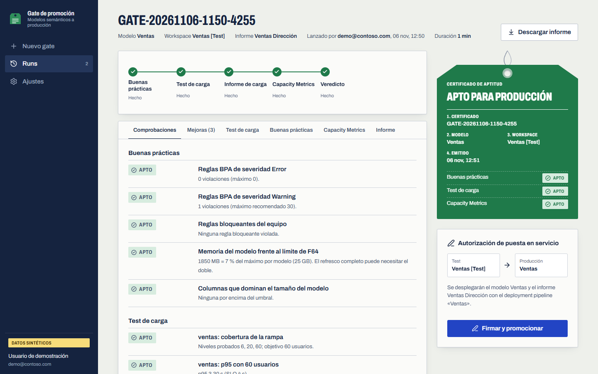

- [Qué comprueba](#qué-comprueba)
- [Arquitectura](#arquitectura)
- [Requisitos](#requisitos)
- [Despliegue en un comando](#despliegue-en-un-comando)
- [Probar con el caso de éxito](#probar-con-el-caso-de-éxito-ventas-retail)
- [Ejecutar la app en local](#ejecutar-la-app-en-local)
- [Recorrido por la app](#recorrido-por-la-app)
- [CLI, CI y plugin](#cli-ci-y-plugin)
- [Umbrales](#umbrales)
- [Tiempos](#tiempos)
- [Resolución de problemas](#resolución-de-problemas)
- [Desarrollo y validación](#desarrollo-y-validación)
- [Desinstalar](#desinstalar)

## Qué comprueba

| Fase | Cómo | Bloquea si |
|---|---|---|
| **Buenas prácticas** | Best Practice Analyzer de semantic-link-labs y estadísticas VertiPaq del modelo | Hay reglas de severidad Error, se viola una regla bloqueante del equipo (por defecto: columnas en coma flotante y relaciones bidireccionales) o el modelo no cabe en el SKU de producción |
| **Test de carga** | Rampa secuencial de usuarios virtuales (por ejemplo 6, 20 y 60) con las consultas DAX y las pausas reales de una grabación de Performance Analyzer | El p95 con los usuarios objetivo supera el SLO o fallan más consultas de las permitidas |
| **Informe de carga** | Percentiles por nivel, nivel sostenido dentro del SLO, visuales y consultas lentas, separando consulta lenta de contención | No bloquea: alimenta las mejoras priorizadas |
| **Capacity Metrics** | Utilización, throttling y carry-over en la ventana exacta del test (timepoints de 30 s), y CU y operaciones del modelo y del propio generador en las horas del test | La capacidad pasa del 80 %, hay rechazo de consultas interactivas u operaciones fallidas del modelo |

El resultado de cada run queda en `Files/PromotionGate/runs/<run_id>/` (`verdict.json`, `report.md` y un JSON por
fase) y en las tablas Delta `gate_runs` y `gate_checks`, que son la auditoría de promociones. Ejemplo de informe:
[docs/ejemplo-informe.md](docs/ejemplo-informe.md).

## Arquitectura

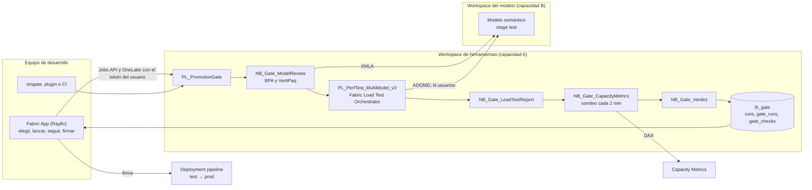

| Pieza | Dónde | Qué hace |
|---|---|---|
| Paquete `promotion_gate` | `src/` | Toda la lógica: evaluadores, asesor, veredicto, informe y la CLI `smgate`. Python puro, con tests sin Fabric |
| Notebooks `NB_Gate_*` | `notebooks/*.py` | Recogen la evidencia en Fabric y escriben un JSON por fase. Cargan el paquete como wheel desde el lakehouse |
| `PL_PromotionGate` | `pipelines/` | Orquesta las fases, llama al orquestador de carga y falla si el modelo no es promocionable |
| Fabric App | `app/` | React y TypeScript sobre Rayfin. Descubre modelos e informes con la identidad del usuario, sube el escenario, lanza y sigue el run, presenta la evidencia y promociona. Guarda el historial del equipo en la base de datos de la app |
| Despliegue | `deploy/deploy.ps1` | Un comando para todo lo anterior |
| Caso de éxito | `demo/caso-exito/` | Modelo Direct Lake, informe y escenario que pasan el gate |
| Plugin y CI | `plugin/`, `ci/` | Uso desde Copilot CLI o Claude Code, y plantillas de GitHub Actions y Azure DevOps con aprobación |

La app no calcula nada: lee las evidencias que escribe el pipeline. Llama a tres APIs desde el navegador con un token
delegado del usuario (MSAL): Fabric (workspaces, jobs y deployment pipelines), Power BI (informes y `executeQueries`)
y OneLake (escenarios y evidencias). Rayfin aporta el hosting, el inicio de sesión de Fabric y la base de datos del
historial.

## Requisitos

**En Fabric**

| Qué | Para qué |
|---|---|
| Workspace de herramientas con capacidad (F4 o superior) | Orquestador, gate y Spark del generador de carga. Mejor en una capacidad distinta de la del modelo, para no contaminar la medida |
| Workspace para la app en una región que admita Fabric Apps | En Spain Central no se pueden desplegar; Sweden Central sí. Puede ser una F2 |
| App [Fabric Capacity Metrics](https://learn.microsoft.com/fabric/enterprise/metrics-app-install) instalada (v40 o posterior) | Fase de capacidad. La identidad que ejecuta el gate necesita lectura en su workspace |
| Ajustes de tenant: Fabric data apps (Rayfin), endpoint XMLA de lectura y «Dataset Execute Queries REST API» | Desplegar la app, BPA y VertiPaq, y el escenario sintético |
| Contributor en el workspace de herramientas y en el del modelo | Lanzar el pipeline y leer el modelo por TOM |
| Un deployment pipeline test → prod (opcional) | Solo para la firma y promoción desde la app |

**En tu equipo:** PowerShell 7, Azure CLI con sesión (`az login`), Python 3.10 o posterior y Node 20 o posterior.
Para crear el registro de la app en Entra hace falta poder crear registros de aplicación; si no, pide uno de tipo SPA
y pásalo con `-SpaClientId`.

**Orquestador:** el gate necesita el Fabric Load Test Orchestrator **3.4.0 o posterior** (`summary.json` por nivel, consultas
fallidas como filas `status = error` y autenticación ADOMD como semantic-link). `deploy.ps1` instala el de este mismo repo.

## Despliegue en un comando

```powershell
pwsh promotion-gate/deploy/deploy.ps1 `
  -ToolsWorkspace "Load Testing" `
  -AppWorkspace "Load Testing App" `
  -CapacityMetricsWorkspace "Microsoft Fabric Capacity Metrics" `
  -SuccessCase -SuccessCaseWorkspace "Load Testing Models" -WhatIf
```

`-WhatIf` resuelve workspaces, capacidades y lakehouse y enseña el plan sin tocar nada. Quítalo para desplegar. El
script es idempotente: repítelo para actualizar.

| Paso | Qué hace |
|---|---|
| Comprobaciones | Identidad de `az`, workspaces, SKU, región y estado de las capacidades (si una está en pausa, para y lo dice), acceso a Capacity Metrics |
| Lakehouse | Crea `lh_gate` en el workspace de herramientas si no existe |
| `orchestrator` | Instala los notebooks y pipelines del Fabric Load Test Orchestrator de este mismo repo, con los ids del workspace resueltos |
| `gate` | Construye el wheel de `promotion_gate` y despliega `NB_Gate_*`, `PL_PromotionGate`, el wheel y `config/gate.yaml` |
| `app` | Crea o reutiliza el registro SPA de Entra con las redirect URIs (`localhost` y la URL de hosting), escribe `app/.env` y ejecuta `rayfin up`, que construye la app, la publica y crea la tabla del historial |
| `-SuccessCase` | Despliega el caso de éxito Ventas Retail en `-SuccessCaseWorkspace` (por defecto, el de herramientas) |

Parámetros útiles:

| Parámetro | Para |
|---|---|
| `-Steps gate,app` | Repetir solo algunos pasos |
| `-SpaClientId <guid>` | Usar un registro SPA existente en lugar de crear `promotion-gate-app` |
| `-Subscription <id>` o `-Tenant <id>` | Pedir los tokens para otra suscripción o tenant sin cambiar la cuenta por defecto de `az` |
| `-SuccessCaseWorkspace <nombre o guid>` | Workspace del modelo de ejemplo. Que esté en **otra capacidad** que el de herramientas: si comparten capacidad, el CU del generador de carga cuenta junto al del modelo y el gate lo marca como observación |
| `-LakehouseName`, `-AppItemName` | Cambiar los nombres por defecto (`lh_gate`, `PromotionGateApp`) |

Al terminar imprime los enlaces y los guarda en `deploy/.deployment.json`:

```text
== Resultado
   tools_workspace              Load Testing
   tools_workspace_id           <guid>
   lakehouse_id                 <guid>
   app_portal                   https://app.fabric.microsoft.com/groups/<guid>/appbackends/<guid>
   app_hosting                  https://<nombre>.webapp.fabricapps.net
```

Abre la app desde `app_portal`. El hosting directo devuelve 401 sin sesión de Fabric (`assetAccess: protected`).

> Las Fabric Apps se ejecutan dentro de un iframe del portal y Edge aísla su almacenamiento del popup de inicio de
> sesión. La app lo resuelve con el relay de MSAL (`popup-relay.html`): al pulsar «Iniciar sesión en Fabric» se abre
> una ventana intermedia con un botón «Continuar» que abre el login de Microsoft. Es un clic más y es lo esperado.

## Probar con el caso de éxito (Ventas Retail)

`-SuccessCase` crea en `-SuccessCaseWorkspace` una carpeta **Ventas Retail** con un modelo que cumple las buenas
prácticas: lakehouse con un esquema en estrella (2 millones de ventas ficticias), notebook de V-Order, modelo Direct
Lake con 0 hallazgos de BPA, informe de tres páginas y el escenario de navegación con las 19 consultas de sus
visuales. Detalle en [demo/caso-exito/README.md](demo/caso-exito/README.md).

En la app:

1. Pulsa **Iniciar sesión en Fabric** y elige tu cuenta.
2. **Modelo semántico:** el workspace del caso de éxito, modelo **Ventas Retail** e informe **Ventas Retail**.
3. **Escenario:** «Reutilizar un escenario ya subido» y `Ventas_Retail_informe.json`.
4. **Carga:** 60 usuarios objetivo, F64, rampa 6, 20 y 60, con las pausas grabadas.
5. **Lanzar gate.** Tarda unos 23 minutos.

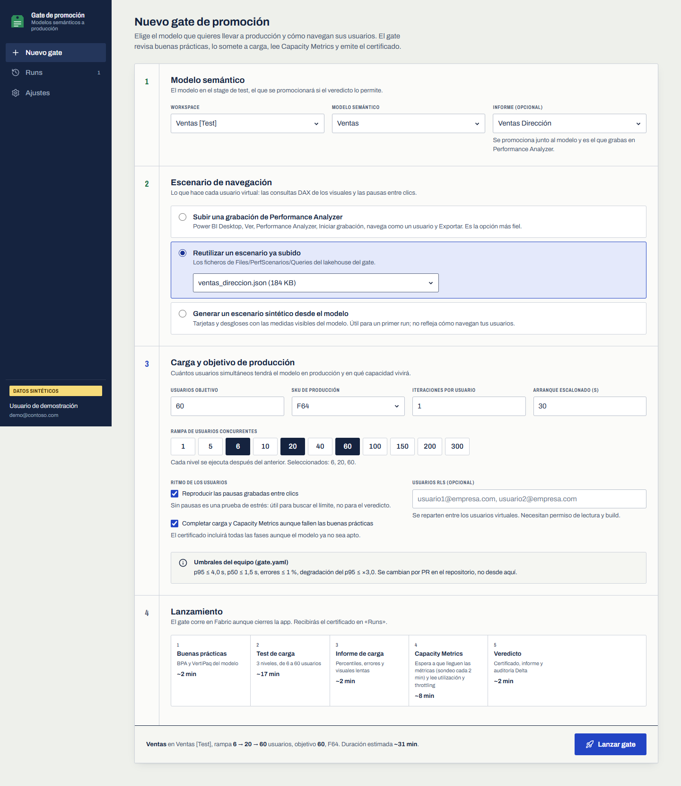

Resultado medido en el tenant de desarrollo, con el gate en una F4 y el modelo en una F8 (26 minutos):

| Área | Resultado |
|---|---|
| Buenas prácticas | 0 errores, 0 avisos, ninguna regla bloqueante |
| Test de carga | 1.634 consultas sin errores. p95 de 0,09 s, 0,10 s y 0,88 s con 6, 20 y 60 usuarios (SLO 4 s) |
| Capacity Metrics | Pico de utilización del 37,5 % de la F8 del modelo, sin throttling; el generador (en la F4) no consume en ella |
| Veredicto | **PASS, promocionable** |

Dos comprobaciones salen como «Omitido» y es lo correcto: el tamaño VertiPaq (sempy no informa tamaños de un modelo
Direct Lake) y las operaciones del modelo por item, que Capacity Metrics publica con más retraso que la utilización.

Para ver un **no apto**, lanza el gate sobre cualquier modelo con importes en `double` o relaciones bidireccionales:
el certificado lo dice y las mejoras explican qué cambiar.

## Ejecutar la app en local

| Modo | Comando (en `app/`) | Backend de la app | Fabric real | Para |
|---|---|---|---|---|
| Demo | `npm run dev:demo` | Ninguno, historial en el navegador | No | Enseñar la app sin Azure; un run sintético recorre las cinco fases en 45 s |
| Local con Fabric | `npm run dev` | El de la app desplegada en Fabric | Sí | Desarrollar la app contra el gate real |
| Backend en Docker (preview de Rayfin) | `npx rayfin dev --provider docker` | Contenedores locales | Sí, para el gate | Trabajar sin tocar la base de datos de la app desplegada |

```powershell
cd promotion-gate/app
npm ci
npm run dev:demo          # http://localhost:5173, todo sintético
npm run dev               # rayfin dev: backend en Fabric, Vite en local
```

`npm run dev` ejecuta `rayfin dev`: reutiliza la app desplegada (o crea un backend nuevo si no hay ninguno),
registra `http://localhost:<puerto>` en el backend, regenera `.env.local` y arranca Vite (`npm run dev:frontend`). La
primera vez pide `npx rayfin login`; para otra cuenta que la de `az`, exporta `RAYFIN_TOKEN` (token de
`https://api.fabric.microsoft.com`) y `RAYFIN_TENANT_ID`. El registro SPA ya tiene `http://localhost:5173/blank.html`
como redirect URI si lo creó `deploy.ps1`.

La configuración de la app vive en dos ficheros que no se versionan:

| Fichero | Lo escribe | Contiene |
|---|---|---|
| `app/.env.local` | Rayfin (`rayfin up`, `rayfin dev` o `npm run env`) | URL y clave publicable del backend, item, workspace y tenant (`VITE_RAYFIN_*`, `VITE_FABRIC_*`) |
| `app/.env` | `deploy.ps1` o tú, desde `app/.env.example` | Cliente SPA de MSAL, workspace y lakehouse del gate y workspace de Capacity Metrics |

Para redesplegar solo el frontend: `npm run deploy:static`. Para todo: `npm run deploy` (o el paso `app` del script).

## Recorrido por la app

**Nuevo gate.** Cuatro bloques: modelo e informe, escenario (subir una grabación de Performance Analyzer, reutilizar
una subida o generar una sintética desde las medidas del modelo), carga y objetivo de producción, y lanzamiento con
el plan de fases y su duración estimada. Por defecto completa la carga y Capacity Metrics aunque fallen las buenas
prácticas; desmarcando la casilla se detiene antes y ahorra capacidad.

**Usuarios RLS.** Si el modelo tiene seguridad por filas, el campo «Usuarios RLS» acepta UPN separados por comas o la ruta
de un fichero del lakehouse del gate con un UPN por línea (por ejemplo `Files/PerfScenarios/Users/ventas.txt`). El gate lo
pasa al orquestador como `rls_users` o `rls_users_file` con `rls_source` (`list`, `file` o `none`) y `rls_scope = global`: un
gate prueba un solo modelo. Las identidades necesitan permiso de lectura y build sobre el modelo.

**Run en curso.** Ruta de fases con los niveles de la rampa en vivo. Se puede cerrar la app: el gate sigue en Fabric.

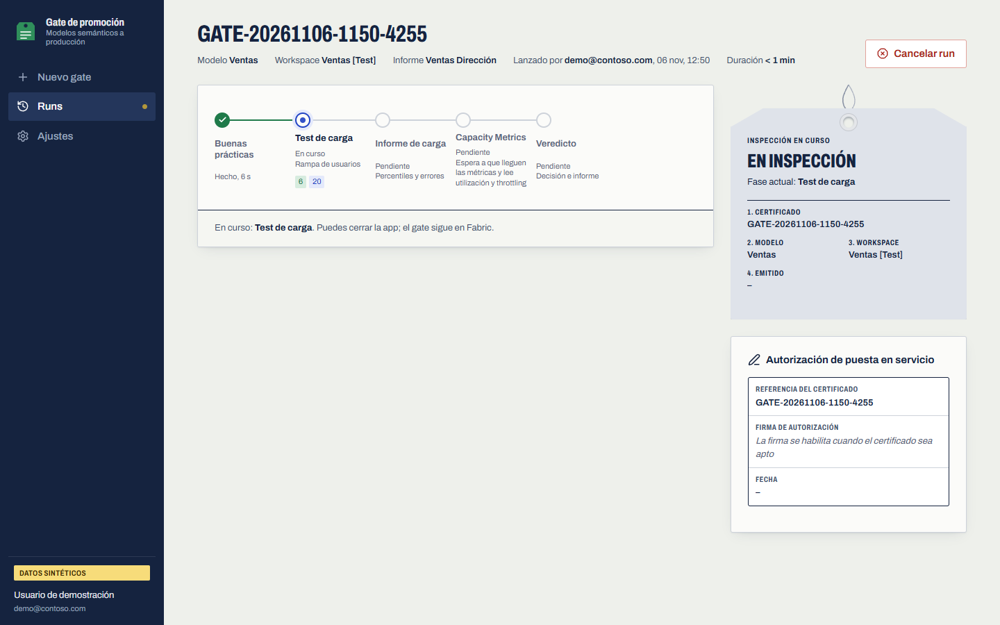

**Certificado.** Etiqueta de veredicto, estado por área y pestañas con toda la evidencia.

| Test de carga | Buenas prácticas |
|---|---|
| 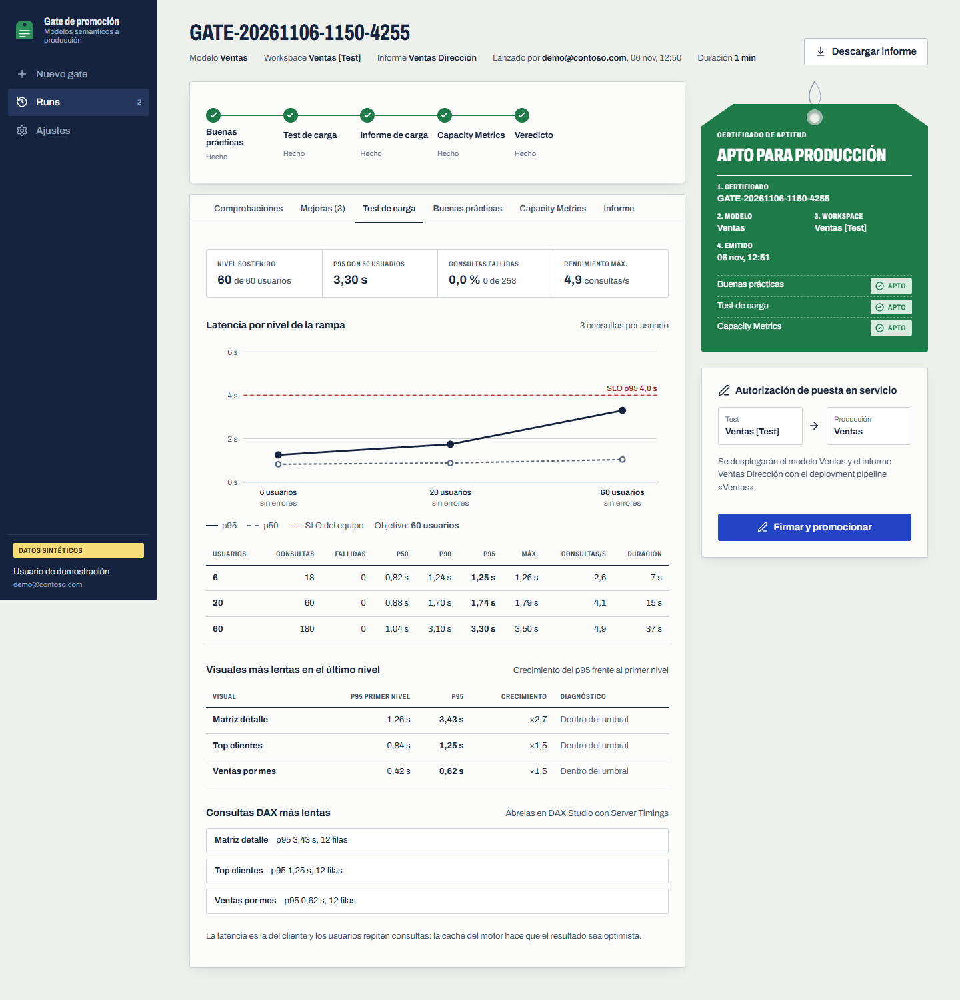 | 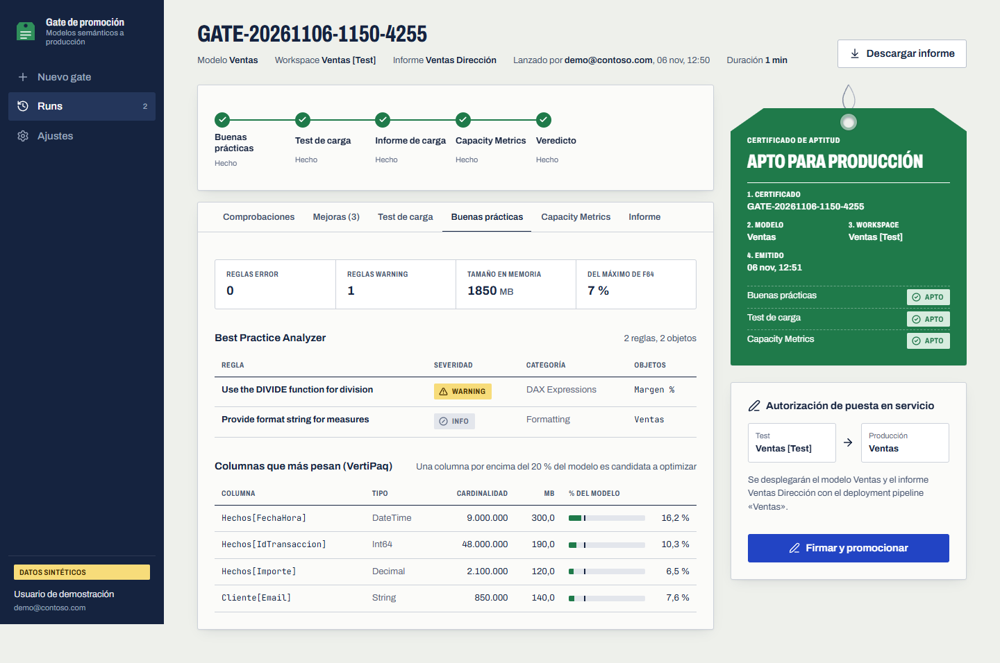 |
| **Capacity Metrics** | **Mejoras priorizadas** |
| 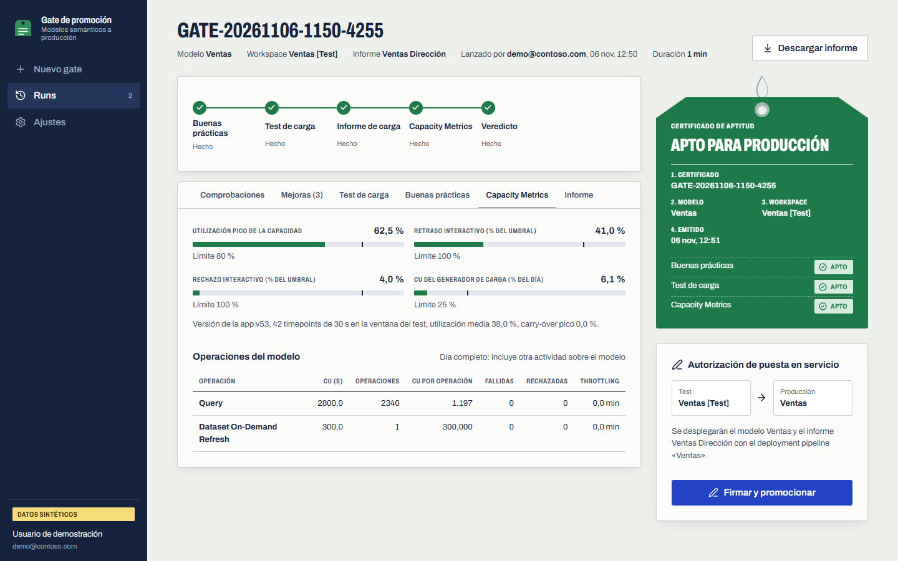 | 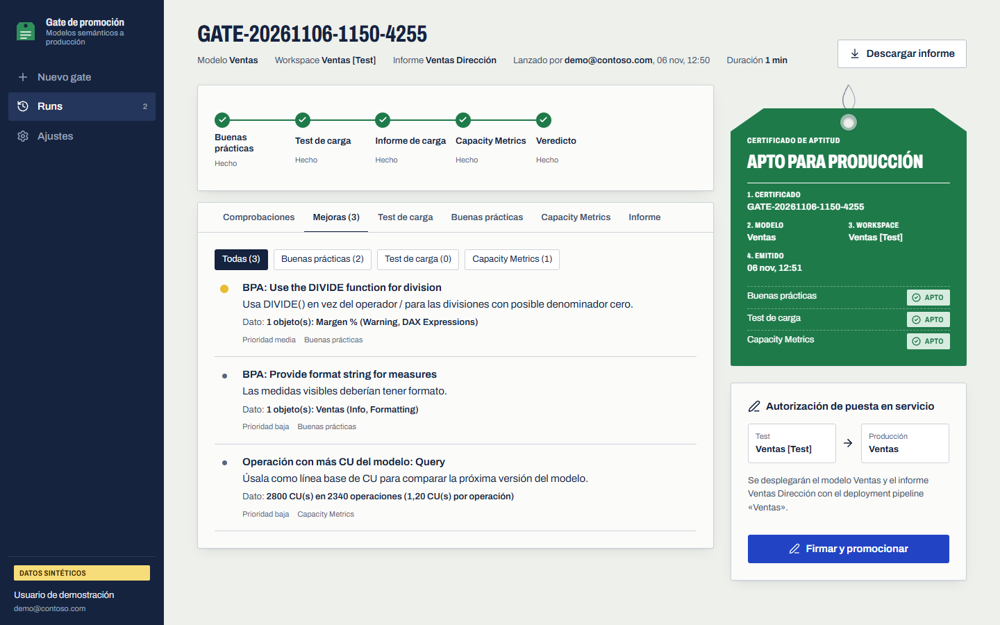 |

**No apto.** La etiqueta de rechazo explica qué falla y la firma queda bloqueada hasta un gate nuevo.

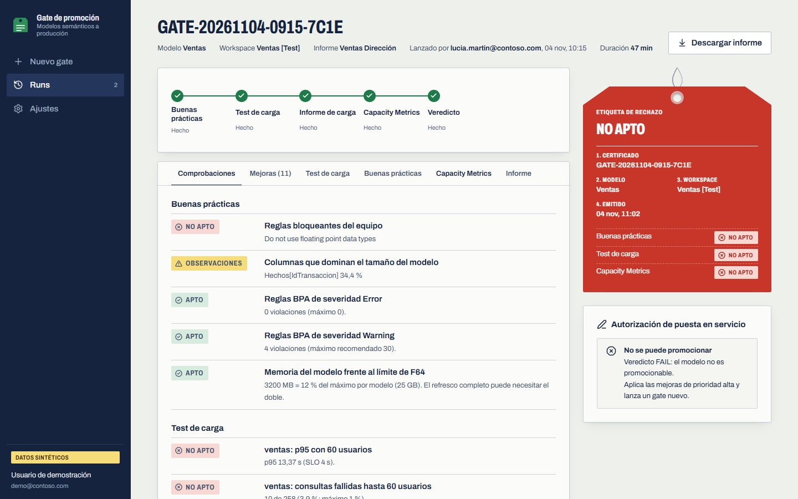

**Firma y promoción.** Con un certificado apto, la app busca el deployment pipeline del workspace del modelo,
enseña la ruta test → producción y despliega el modelo y su informe tras escribir el nombre del modelo.

**Historial y ajustes.** Todos los runs del equipo, y la conexión, los umbrales de `gate.yaml` y los permisos que pide
la app.

| Historial | Ajustes |
|---|---|
| 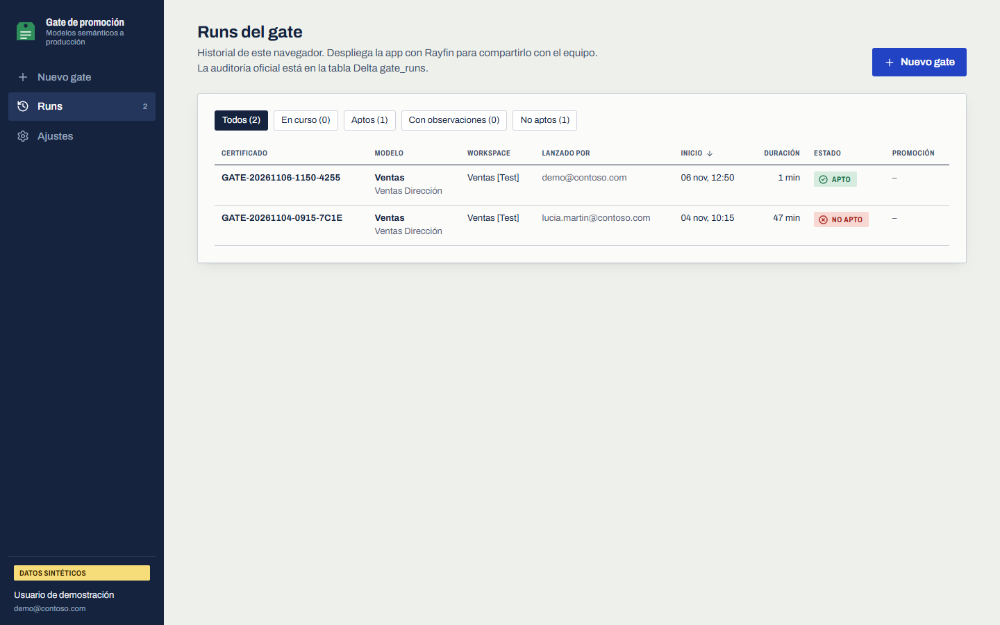 | 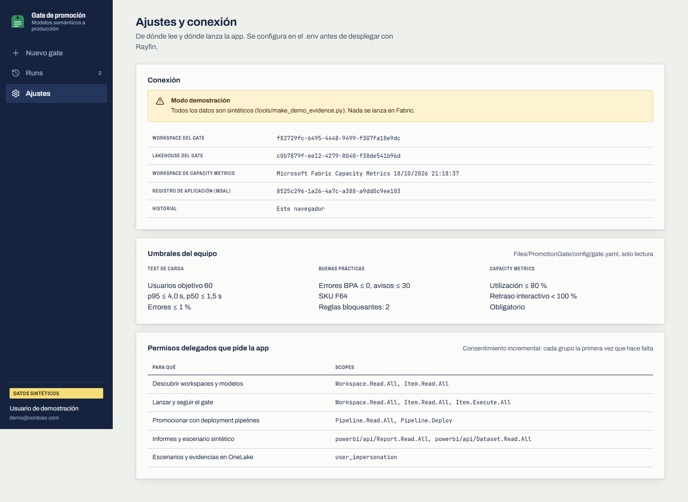 |

Las capturas son del modo demo (`npm run dev:demo`): la misma app con evidencias sintéticas.

## CLI, CI y plugin

`smgate` se instala con el paquete (`pip install -e ".[cli]"`) y usa la identidad de Azure CLI
(`SMGATE_AZ_SUBSCRIPTION` o `SMGATE_AZ_TENANT` para otra suscripción o tenant).

| Comando | Para |
|---|---|
| `smgate upload --file ventas.json` | Subir una grabación de Performance Analyzer |
| `smgate run --param dataset="Ventas" ... --wait --out out\ventas` | Lanzar el gate y descargar el veredicto |
| `smgate run-item --name NB_Gate_CapacityMetrics` | Repetir una fase de un run |
| `smgate fetch --run-id <id>` | Descargar las evidencias de un run |
| `smgate evaluate` | Recalcular el veredicto en local con otros umbrales |
| `smgate promote --dry-run` | Ver qué desplegaría el deployment pipeline |
| `smgate capacity-dax` | Las consultas DAX de Capacity Metrics, para lanzarlas a mano |
| `smgate install-orchestrator`, `smgate deploy` | Lo que hace `deploy.ps1` por pasos |

```powershell
smgate run --workspace-id <tools> --lakehouse-id <lh_gate> --wait --out out\ventas-retail `
  --param dataset="Ventas Retail" --param model_workspace="Load Testing" --param model_key=ventas-retail `
  --param queryfile=/lakehouse/default/Files/PerfScenarios/Queries/Ventas_Retail_informe.json `
  --param ramp_levels="[6,20,60]" --param capacity_metrics_workspace="Microsoft Fabric Capacity Metrics" `
  --param stop_on_review_fail=false
```

- **CI:** `ci/github/promotion-gate.yml` y `ci/azure-devops/promotion-gate.yml` lanzan el gate en cada PR del modelo y
  promocionan tras la aprobación del entorno `production`.
- **Plugin:** `plugin/` tiene cinco skills y un agente para pedirlo en lenguaje natural («el modelo Ventas está listo
  para producción, pasa el gate»). Se instala con `copilot plugin marketplace add ./promotion-gate` o con
  `/plugin marketplace add ./promotion-gate` en Claude Code.

## Umbrales

Los fija el equipo en `config/gate.yaml` y `deploy.ps1` los sube al lakehouse. Desde la app solo se ajustan, por run,
los usuarios objetivo y el SKU.

| Umbral | Por defecto |
|---|---|
| Reglas BPA de severidad Error | 0 |
| Reglas bloqueantes | Coma flotante y relaciones bidireccionales |
| Memoria del modelo frente al SKU | 50 % del máximo por modelo |
| Usuarios objetivo | 60 |
| p95 y p50 con los usuarios objetivo | 4 s y 1,5 s |
| Consultas fallidas | 1 % |
| Degradación del p95 entre el primer y el último nivel | ×3, solo si el p95 pasa de 1 s |
| Utilización de la capacidad | 80 % |
| Retraso interactivo | Aviso al 80 %, bloqueo al 100 % |
| `warn_blocks_promotion` | `false`: un veredicto con observaciones se puede promocionar |

## Tiempos

Medido en F4 con rampa 6, 20 y 60, una iteración y pausas grabadas: **unos 23 minutos**.

| Fase | Duración | Qué pesa |
|---|---|---|
| Buenas prácticas | 1 a 2 min | BPA, VertiPaq y, en Direct Lake frío, el calentado de columnas |
| Test de carga | unos 18 min | Por nivel: unos 2 min de sesión Spark, la carga real (1 a 3 min) y arrancar un notebook por usuario virtual |
| Informe de carga | menos de 1 min | |
| Capacity Metrics | 2 a 8 min | Sondeo cada 2 min hasta que los datos cubren el final del test (máximo `metrics_lag_minutes`, 20) |
| Veredicto | menos de 1 min | |

Más usuarios por nivel alargan sobre todo el test de carga. Desglose y lo que se probó para acortarlo:
[docs/runbook.md](docs/runbook.md).

## Resolución de problemas

| Síntoma | Causa y solución |
|---|---|
| `deploy.ps1` dice que una capacidad está en pausa | Reanúdala en Azure o en el portal de Fabric y repite |
| `rayfin up` falla en un workspace de Spain Central | La región no admite Fabric Apps: usa un workspace en otra región para la app |
| La app se queda sin sesión tras el login | Ábrela desde el portal (`app_portal`) y recarga con Ctrl+F5. El registro SPA necesita `<hosting>/blank.html` como redirect URI; `deploy.ps1` la añade |
| «Falta configuración de la app» | Falta `app/.env`: ejecuta el paso `app` de `deploy.ps1` o copia `app/.env.example` |
| Todas las consultas del test fallan con «Authentication failed for all authenticators» | Orquestador anterior a la autenticación con semantic-link (3.4.0): repite el paso `orchestrator` |
| Capacity Metrics «sin datos en la ventana del test» | La app tarda en reflejar el consumo: sube `metrics_lag_minutes` o repite solo `NB_Gate_CapacityMetrics` y `NB_Gate_Verdict` con `smgate run-item` |
| «Operaciones del modelo pendientes en Capacity Metrics» (omitido) | La tabla por item y hora aún no incluye el test. No bloquea; la utilización y el throttling sí están medidos. Repite `NB_Gate_CapacityMetrics` más tarde para ver CU y operaciones |
| Capacity Metrics con datos de otra hora | La app guarda los timepoints en la hora local de su instalación (`'Latest Summary Timestamp'[UTC Offset]`). El gate lo lee y convierte a UTC; el informe dice qué desfase usó |
| «Consumo del propio generador de carga» con observaciones | El modelo y el workspace de herramientas comparten capacidad. Pon el modelo en otra capacidad |
| `MagicUsageError: %pip is not supported in high concurrency session` | Notebooks antiguos con `%pip`: los actuales cargan el wheel por `sys.path`. Repite el paso `gate` |
| El gate no lanza el test de carga | La revisión del modelo es FAIL y se lanzó con `stop_on_review_fail = true` (casilla desmarcada en la app) |
| BPA marca «Ensure Direct Lake source tables are V-Ordered» | Las tablas Delta se escribieron sin V-Order: reescríbelas con Spark (`spark.sql.parquet.vorder.default = true`) |

## Desarrollo y validación

```powershell
cd promotion-gate
python -m venv .venv; .\.venv\Scripts\Activate.ps1
pip install -e ".[cli,dev]"
python -m pytest                      # 69 tests, sin Fabric

cd app
npm ci
npm run typecheck; npm test; npm run build
```

- Una sola fuente de lógica: `src/promotion_gate/`. Los notebooks se editan como `.py` (celdas `# %%`) y `smgate deploy`
  los convierte a ipynb.
- Los parámetros que la app envía al pipeline deben existir en `pipelines/PL_PromotionGate.json` (lo comprueba
  `app/src/lib/gate.test.ts`), y los que el gate pasa al orquestador, en `PL_PerfTest_MultiModel_v3`.
- Evidencias del modo demo: `python tools/make_demo_evidence.py`. Capturas: `npm run dev:demo` y cualquier navegador.

## Desinstalar

```powershell
pwsh promotion-gate/deploy/teardown.ps1 -ToolsWorkspace "Load Testing" -AppWorkspace "Load Testing App" -App -WhatIf
```

Lista lo que borraría; sin `-WhatIf` lo borra tras escribir el nombre del workspace. Quita `NB_Gate_*`,
`PL_PromotionGate` y, con `-App`, la app. Conserva el orquestador, el lakehouse, los runs y las tablas `gate_*`, que son
la auditoría de promociones. El registro `promotion-gate-app` de Entra y la carpeta **Ventas Retail** se borran a mano.
