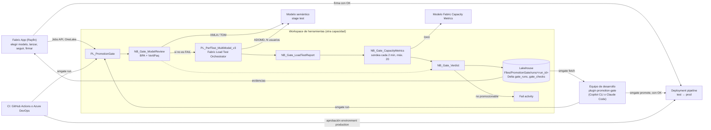

# Arquitectura del gate de promoción

## Flujo

## Piezas

| Pieza | Dónde | Qué hace |
|---|---|---|
| `promotion_gate` (wheel) | `src/`, subido a `Files/PromotionGate/lib/` | Evaluadores, asesor, veredicto, informe. Python puro, testeado fuera de Fabric |
| `NB_Gate_*` | `notebooks/*.py` → ipynb al desplegar | Recogen evidencia en Fabric y escriben un JSON por fase |
| `PL_PromotionGate` | `pipelines/` | Orquesta las fases, llama al orquestador y falla si no es promocionable |
| Fabric Load Test Orchestrator | Repo de Pablo Ahumada, se instala con `Setup_LoadTest_v3` | Rampa de usuarios con think times |
| `smgate` | CLI | `deploy`, `upload`, `run`, `run-item`, `fetch`, `evaluate`, `promote`, `capacity-dax` |
| Fabric App | `app/` (Rayfin, React) | Interfaz del equipo: descubre modelos e informes con su identidad, sube el escenario, lanza y sigue el run, presenta la evidencia y promociona; historial en la SQL DB de la app |
| Plugin `semantic-model-promotion-gate` | `plugin/` | 5 skills y un agente para que el equipo lo use en lenguaje natural |
| Plantillas de CI | `ci/` | Gate automático y promoción con aprobación manual |

## Contrato de datos (por run)

`Files/PromotionGate/runs/<run_id>/`

| Fichero | Lo escribe | Contenido |
|---|---|---|
| `model_review.json` | `NB_Gate_ModelReview` | `item_id`, hallazgos BPA normalizados, resumen VertiPaq o `error` |
| `loadtest.json` | `NB_Gate_LoadTestReport` | Por modelo y nivel: percentiles, consultas, fallidas, QPS, ventana UTC, visuales y DAX lentos |
| `capacity.json` | `NB_Gate_CapacityMetrics` | Versión de la app, picos de utilización y throttling, CU y operaciones del modelo, CU del generador |
| `verdict.json` | `NB_Gate_Verdict` | Veredicto, `promotable`, estado por área, comprobaciones, recomendaciones y umbrales usados |
| `report.md` | `NB_Gate_Verdict` | Informe legible (PR, chat, lakehouse) |

Tablas Delta en el lakehouse: `gate_runs` (una fila por veredicto) y `gate_checks` (una fila por comprobación).
Son la auditoría de promociones y la base para ver la evolución de un modelo entre versiones.

## Decisión

Cada comprobación sale PASS, WARN, FAIL o SKIP. El área toma el peor estado y el veredicto el peor de todas.
FAIL nunca promociona; WARN promociona salvo `verdict.warn_blocks_promotion: true`. La falta de evidencia de una
fase es FAIL (Capacity Metrics puede hacerse opcional con `capacity.required: false`). Umbrales en
[`config/gate.yaml`](../config/gate.yaml).

| Área | FAIL | WARN |
|---|---|---|
| Revisión del modelo | Reglas BPA Error, reglas bloqueantes del equipo, revisión sin evidencia | Demasiados Warning, memoria alta frente al SKU, columnas que dominan el modelo |
| Test de carga | p95 al nivel objetivo por encima del SLO, tasa de error, un nivel hasta el objetivo sin ninguna consulta correcta, sin resultados | p50, rampa que no llega al objetivo, degradación del p95, nivel sostenido menor que el objetivo |
| Capacity Metrics | Utilización pico, retraso o rechazo interactivo al 100 %, operaciones fallidas del modelo, sin datos o datos que no llegan al final del test | Retraso o rechazo cerca del umbral, generador con mucho CU en la misma capacidad |

## Identidades y permisos

| Identidad | Permisos |
|---|---|
| Quien lanza (usuario o service principal de CI) | Contributor en el workspace de herramientas; Fabric API habilitada para service principals si es CI |
| Identidad que ejecuta los notebooks (la que lanza el job) | Contributor en el workspace del modelo (BPA y VertiPaq usan TOM), read y build para la carga, lectura del workspace de Capacity Metrics |
| Promoción | Admin del deployment pipeline o Contributor en los stages origen y destino |

XMLA de lectura habilitado en la capacidad del modelo. Si el modelo usa RLS, `rls_users` con UPNs de prueba o `rls_users_file` con la ruta de un fichero del lakehouse (un UPN por línea), con read y build.

## Por qué así

- **Fabric como runtime**: BPA, VertiPaq y Capacity Metrics necesitan `sempy` dentro de Fabric; la carga necesita Spark. El CI solo lanza y lee.
- **Una sola fuente de lógica**: notebooks, CLI y plugin usan el mismo paquete, así que el veredicto es idéntico en el chat, en CI y en Fabric.
- **Evidencia en ficheros por run**: cualquier fase se puede repetir (`smgate run-item`) sin rehacer el test de carga, y el veredicto se puede recalcular en local con otros umbrales (`smgate evaluate`).
- **Capacity Metrics con las consultas de FUAM**: el modelo de la app no está documentado y cambia entre versiones; FUAM ya mantiene la detección de versión.
